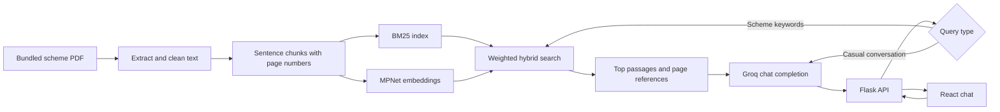

# Yojna Tau

A document-grounded chat assistant for exploring Haryana government schemes, benefits, and eligibility criteria.

Yojna Tau pairs a React interface with a Python/Flask retrieval-augmented generation (RAG) backend. It searches a bundled PDF using both keyword matching and sentence embeddings, then sends relevant passages to a Groq-hosted language model with instructions to cite source pages.

## Highlights

- **Hybrid retrieval:** BM25 keyword scores (30%) combined with normalized sentence-embedding cosine similarity (70%).
- **Document-grounded answers:** retrieves up to three passages above a 0.4 relevance threshold and prompts the model to cite page numbers or acknowledge missing information.
- **Conversational interface:** English/Hindi interface labels, loading and error states, and a new-chat action.
- **Page-aware processing:** extracts PDF text, cleans it, and groups sentences into roughly 500-character chunks while retaining page numbers.
- **Configurable setup:** backend credentials, model, PDF path, and frontend API origin are set through environment variables.

## How it works



The embedding model is `sentence-transformers/all-mpnet-base-v2`. Both the BM25 index and embedding matrix are built in memory on the first chat/reset request; there is no vector database. Groq streams tokens to the backend, which returns the completed conversation as JSON rather than streaming it to the browser.

## Technology

| Layer | Tools |
| --- | --- |
| Interface | React 18, CSS, Axios, Create React App |
| API | Python, Flask, Flask-CORS |
| Document processing | PyPDF2, NLTK |
| Retrieval | Sentence Transformers, PyTorch, NumPy, rank-bm25 |
| Generation | Groq SDK and a configurable hosted chat model |

## Repository layout

```text
.
├── backend/
│   ├── app.py                 # PDF processing, hybrid retrieval, prompts, API
│   ├── all_in_one.pdf         # Bundled knowledge source
│   ├── requirements.txt       # Existing pinned Python environment
│   └── .env.example
├── frontend/
│   ├── public/                # HTML and browser assets
│   ├── src/
│   │   ├── assets/            # Character artwork, send icon, fonts
│   │   ├── App.js             # Chat interface and API calls
│   │   └── App.css
│   ├── package.json
│   ├── package-lock.json
│   └── .env.example
├── tests/                     # Isolated backend regression checks
└── README.md
```

## Run locally

Use **Python 3.11** for the pinned backend packages, plus Node.js and npm. Python 3.14 is not a suitable target for the existing PyTorch 2.5.1 pins. A fresh Groq API key is required for chat. The first chat request needs internet access to download the embedding model and NLTK tokenizer data; allow extra time for indexing.

### 1. Backend

From the repository root, in PowerShell:

```powershell
python -m venv .venv
.\.venv\Scripts\Activate.ps1
python -m pip install -r backend/requirements.txt
Copy-Item backend/.env.example backend/.env
```

On macOS/Linux, activate with `source .venv/bin/activate` and copy with `cp backend/.env.example backend/.env`.

Edit `backend/.env` and supply your own `GROQ_API_KEY`, then start the API:

```powershell
python backend/app.py
```

The server listens at `http://127.0.0.1:10000`. Check `GET /` to confirm Flask is running; this endpoint does not initialize the RAG system.

| Backend variable | Purpose / default |
| --- | --- |
| `GROQ_API_KEY` | Required secret, read only by the backend |
| `GROQ_MODEL` | Hosted chat model; defaults to `openai/gpt-oss-120b` |
| `PDF_PATH` | Defaults to `all_in_one.pdf`; relative paths resolve from `backend/` |
| `PORT` | HTTP port; defaults to `10000` |

The original hardcoded Llama 3.1 70B endpoint has been retired. Select an available model for your account using the [Groq model catalog](https://console.groq.com/docs/models) and [deprecation notices](https://console.groq.com/docs/deprecations). Changing models can affect answer quality and formatting.

### 2. Frontend

In a second terminal, from the repository root:

```powershell
cd frontend
Copy-Item .env.example .env
npm ci
npm start
```

Open `http://localhost:3000`. `REACT_APP_API_URL` defaults to `http://127.0.0.1:10000`; set it to the backend origin without `/chat` when deploying. Restart the development server or rebuild after changing it. Never put API keys in frontend variables: React embeds these values in browser assets.

### 3. Try a conversation

- “Tell me about pension schemes in Haryana.”
- “What documents are required to apply?”
- “योजना की पात्रता क्या है?”

Compare page references with the bundled PDF when assessing an answer. The language toggle translates interface labels; it does not force the model to answer in that language.

## API

| Method | Endpoint | Behavior |
| --- | --- | --- |
| `GET` | `/` | Lightweight server check, HTTP 200 |
| `POST` | `/chat` | Accepts a nonempty string `message`; returns `conversation_history` |
| `POST` | `/clear_history` | Resets shared history to the system prompt |

```bash
curl -X POST http://127.0.0.1:10000/chat -H "Content-Type: application/json" -d '{"message":"Tell me about pension schemes"}'
```

A successful chat response contains messages with `role` and `content` fields, including the system message; the UI hides system messages. Invalid message payloads return HTTP 400. Initialization failures return server errors. Some generation errors are currently returned as assistant text inside HTTP 200 responses.

## Validation

With the backend dependencies installed (or just `python -m pip install -r tests/requirements.txt` in a Python 3.11 environment):

```powershell
python -m unittest discover -s tests -v
cd frontend
npm run build
```

The backend regression suite uses real Flask/NumPy behavior with mocked model, PDF, and provider dependencies. It makes no external API calls or model downloads and checks retrieval edge cases, request validation, lazy initialization, and reset behavior. It does not measure retrieval quality or generated-answer accuracy. For an end-to-end check, configure a fresh key, run both servers, submit a scheme question, compare its citations with the PDF, and try New Chat.

## Scope and limitations

- This is a portfolio prototype. Conversation history is shared across clients in each backend process and resets on restart. Refreshing the frontend also clears it. Use a single local demo session; per-user sessions are future work.
- Scheme answers depend on a static bundled PDF, whose publication date and provenance are not documented here. No live scheme updates or OCR are implemented. Validate benefits and eligibility with the relevant authority.
- Routing uses a keyword heuristic. Relevant questions without those keywords may take the casual-chat path. Page citations and document grounding are prompt instructions, not mechanically verified guarantees.
- Chunking groups sentences without overlap; a single long sentence may exceed the target size. Multilingual retrieval quality has not been evaluated.
- There is no authentication, rate limiting, persistent index, or request-level history isolation. CORS is open for development, and the Flask development server is used locally. Deployment requires appropriate session handling and server configuration.
- The dependency pins are inherited from the original implementation. A dependency modernization/security audit and model-quality benchmark are separate follow-up work.

## Portfolio description

> Built a React and Flask RAG assistant for Haryana government-scheme discovery, combining BM25 keyword retrieval with MPNet sentence embeddings and Groq-hosted generation to produce document-grounded answers with page references and an English/Hindi interface.

No accuracy, latency, usage, or impact metrics are claimed without measurements. Before publishing a demo, add an actual screenshot or recording, verify end-to-end behavior with your own credentials, and confirm redistribution rights for the bundled PDF, artwork, and fonts. No project license has been selected.

## Credential handling

Local `.env` files are ignored by Git. A credential was previously embedded in the backend source: revoke that key in Groq and create a fresh one before using or sharing the project. Removing it from the working tree does not remove it from earlier commits. If sharing repository history, remove the exposed credential from that history through a separately reviewed cleanup.
